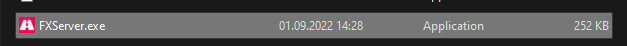
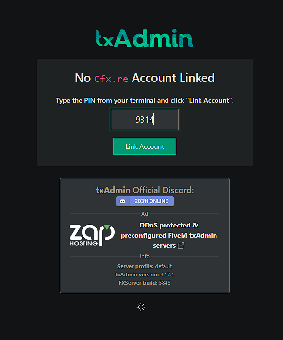
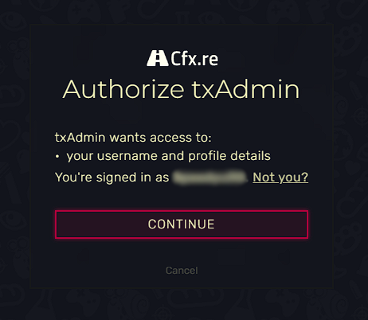
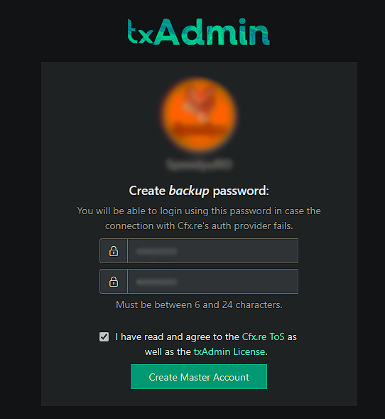
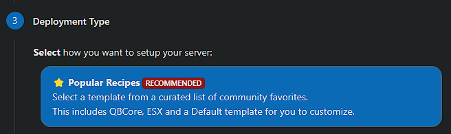
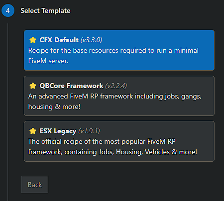
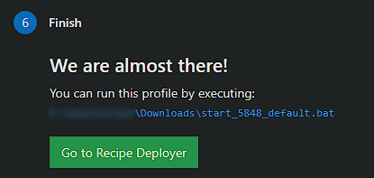
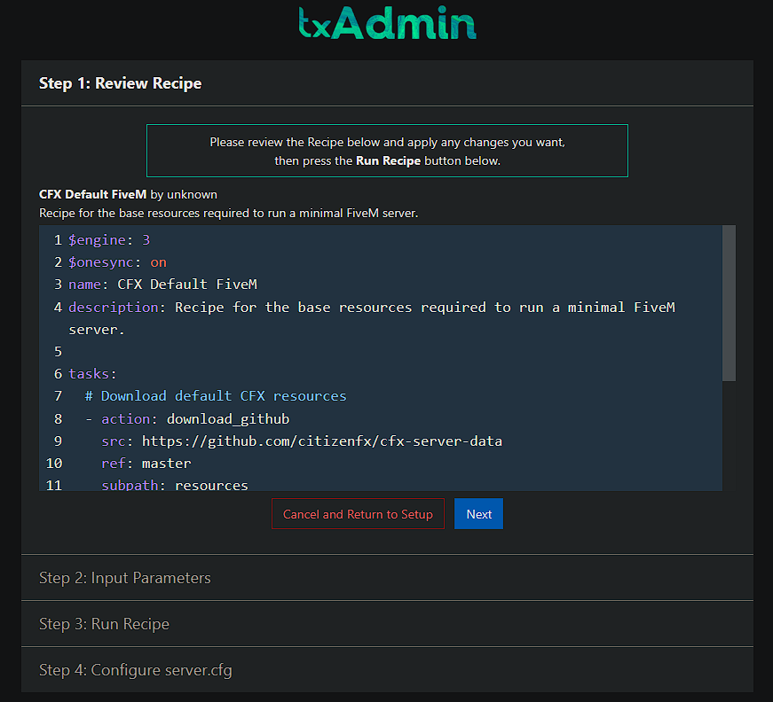

# FXServer on Windows

This guide installs a FiveM server (FXServer) on a Windows VPS or dedicated server.


You need a **Cfx.re account** to link and run the server.




### Check the files

Make sure all the necessary files are present in the extracted directory to avoid startup errors. When the files are correctly downloaded and in place, continue with starting the server.



### Start the server

Double-click `FXServer.exe`, or launch it from CMD/Terminal.

<figure><figcaption></figcaption></figure>




### Link your account with the PIN

A page should open in your browser. Make sure the PIN is filled in and click **Link Account**.

<figure><figcaption>
You can find the code in the console that opened together with the .exe
</figcaption></figure>




### Log in to Cfx.re

Log in to your Cfx.re account in this tab, then click **Yes, Allow**.

<figure><figcaption></figcaption></figure>




### Set a password and accept the terms

1. Set a password to access your server's administration page.
2. Accept the terms and conditions.

<figure><figcaption></figcaption></figure>




### Name your server

Enter a name for your server and click **Next**, then select **Popular Recipes**.

<figure><figcaption></figcaption></figure>




### Choose a template

Choose the **CFX Default** template for now. Other templates exist, but some of them need a database server (XAMPP or [MariaDB](../vps-dedicated/windows/mariadb-heidisql.md)).

<figure><figcaption></figcaption></figure>




### Save and open the Recipe Deployer

Click **Save** (or choose a different path for the data), then go to **Recipe Deployer**.

<figure><figcaption>
The text in blue may differ, depending on the path you selected.
</figcaption></figure>




### Deploy the recipe

Click **Next** after checking that the recipe looks good. It should be fine as it comes.

<figure><figcaption></figcaption></figure>




Remember to open port `30120` (TCP and UDP). See [Open ports on Windows](../vps-dedicated/windows/windows-ports.md).

