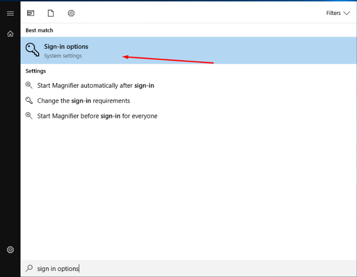
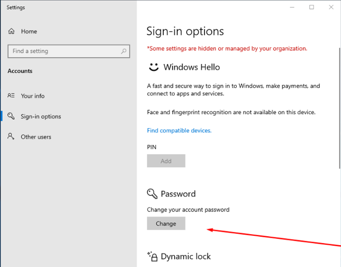
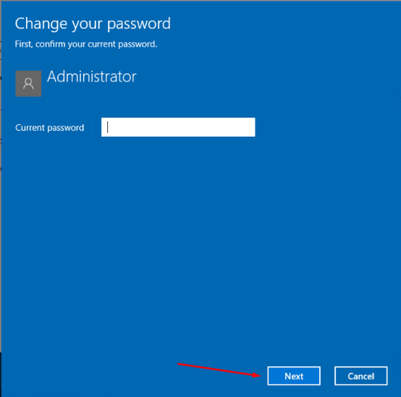
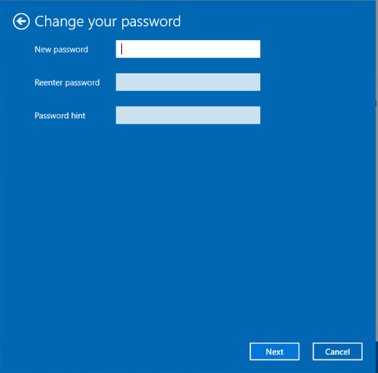

# Change your Windows password

Follow these steps carefully to change your Windows password through Remote Desktop.



### Connect with RDP

Use Remote Desktop Connection (RDP) to access your VPS. See [Connect with RDP](rdp-connect.md) if you need help.



### Search for "sign-in"

Open the Windows Start menu and search for **sign-in**.

<figure><figcaption></figcaption></figure>



### Open "Change Password"

Press Enter to go to the **Change Password** page.

<figure><figcaption></figcaption></figure>



### Enter the current password

Type your current password and click **Next**.

<figure><figcaption></figcaption></figure>



### Set the new password

Enter and confirm the new password. Add a password hint to help you remember it later.

<figure><figcaption></figcaption></figure>




Choose a strong password. Keep the hint meaningful to you, but not obvious to others.

