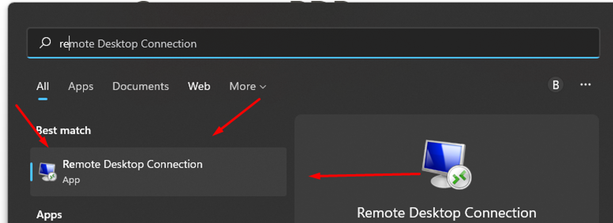
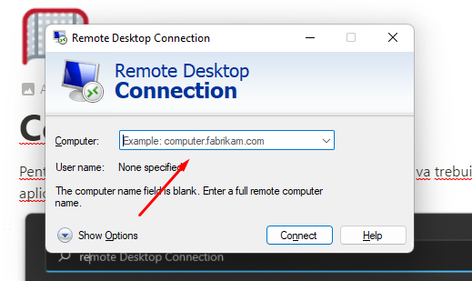
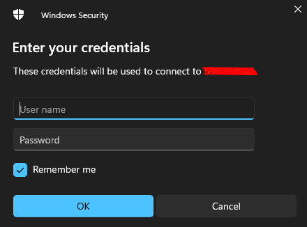
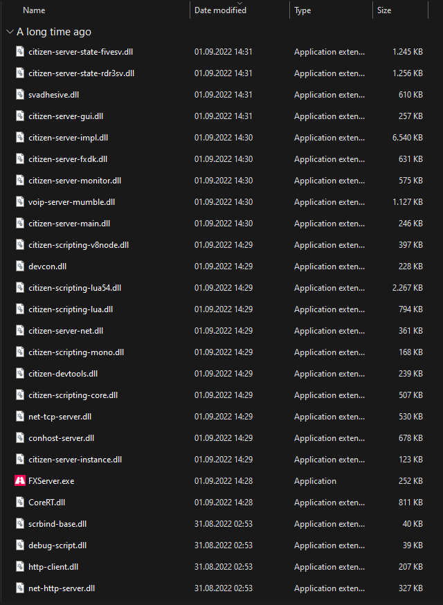

# Connect with RDP

Follow the steps below to connect to your VPS or dedicated server running Windows.



### Open Remote Desktop Connection

The application is already installed on your PC. Search for **Remote Desktop Connection** in the Start menu.

<figure><figcaption></figcaption></figure>



### Enter the VPS IP

Fill in the empty field with the IP address of your VPS.

<figure><figcaption></figcaption></figure>



### Authenticate

* **Username:** `Administrator`
* **Password:** the one shown in your client area at [my.rhqhosting.com](https://my.rhqhosting.com).

<figure><figcaption></figcaption></figure>



### Confirm the connection

After authenticating, click **Yes** in the window that appears.

<figure><figcaption></figcaption></figure>




Cannot connect? Make sure TCP port `3389` is allowed in your [firewall](../network/firewall.md). To change the password afterwards, see [Change your Windows password](password-reset.md).

