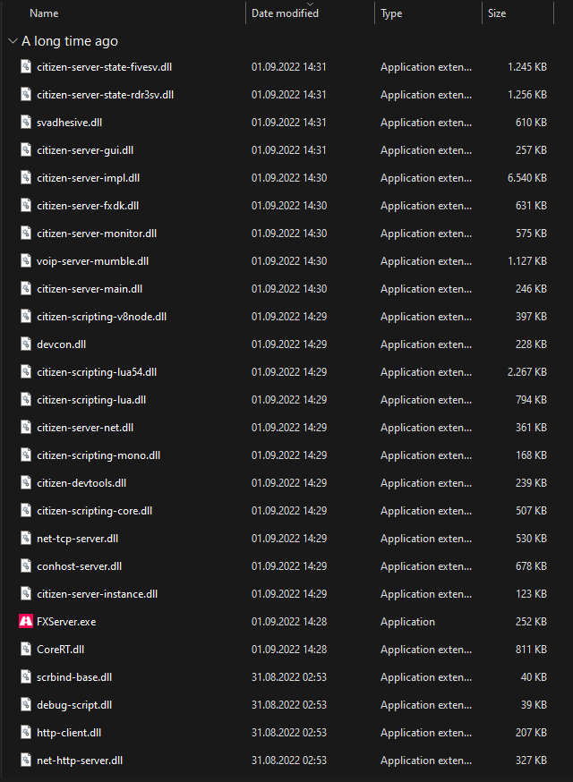
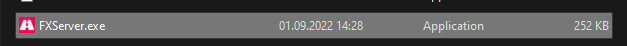
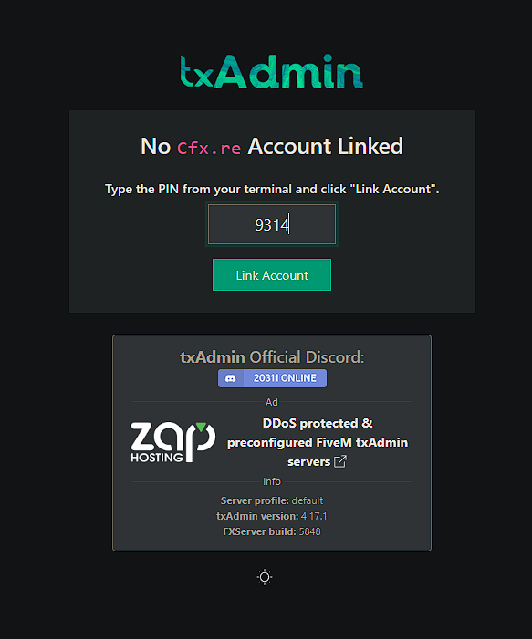
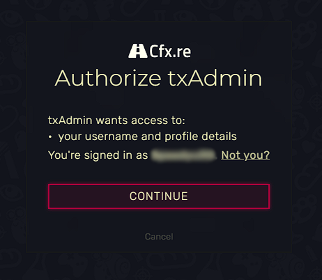
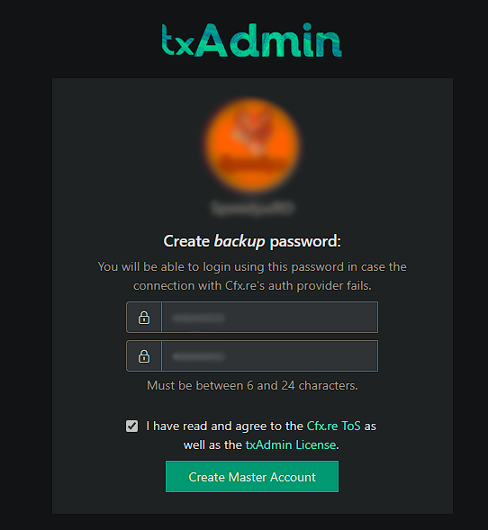
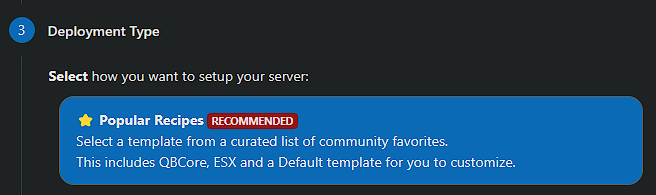
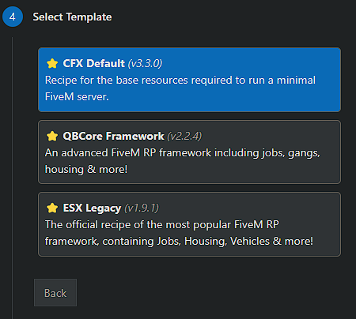
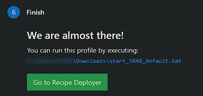
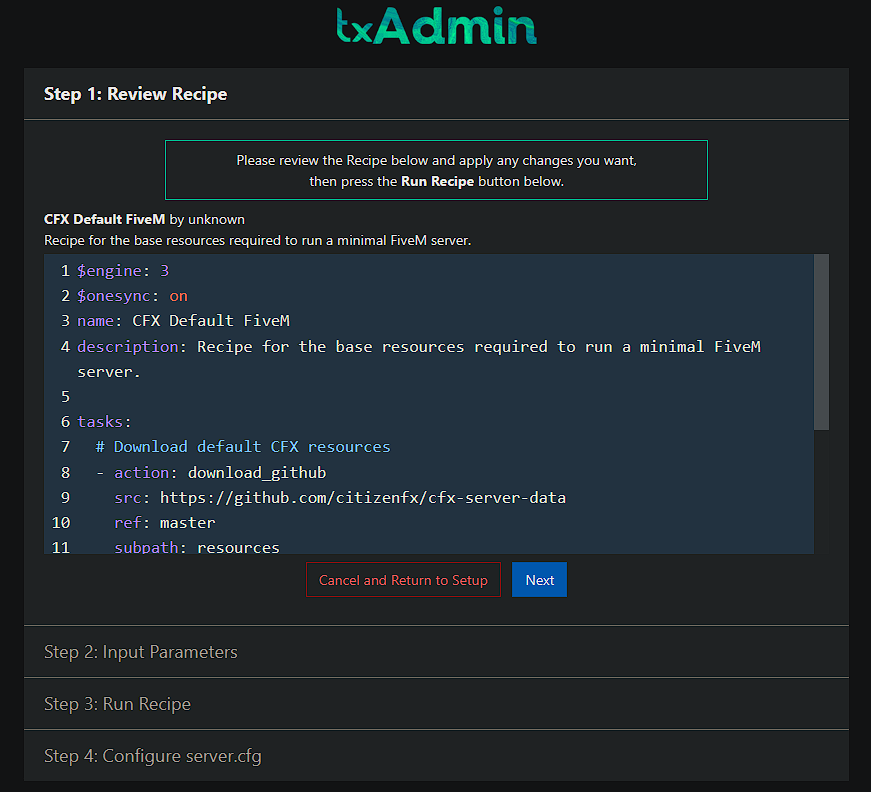

# FXServer pe Windows

Acest ghid instalează un server FiveM (FXServer) pe un VPS sau server dedicat cu Windows.


Ai nevoie neapărat de un **cont Cfx.re** ca să legi și să rulezi serverul.




### Verifică fișierele

Asigură-te că toate fișierele necesare sunt prezente în directorul extras, ca să eviți erorile la pornire. După ce fișierele sunt descărcate și plasate corect, treci la pornirea serverului.

<figure><figcaption></figcaption></figure>



### Pornește serverul

Dă dublu clic pe `FXServer.exe` sau pornește-l din CMD/Terminal.

<figure><figcaption></figcaption></figure>




### Leagă contul cu PIN-ul

O pagină ar trebui să se deschidă în browser. Asigură-te că PIN-ul este completat și apasă **Link Account**.

<figure><figcaption>
Codul îl găsești în consola care a pornit odată cu .exe-ul
</figcaption></figure>




### Autentifică-te la Cfx.re

Conectează-te la contul tău Cfx.re în această filă, apoi apasă **Continue**.

<figure><figcaption></figcaption></figure>




### Setează o parolă și acceptă termenii

1. Setează o parolă pentru a te conecta la pagina de administrare a serverului.
2. Acceptă termenii și condițiile.

<figure><figcaption></figcaption></figure>




### Dă un nume serverului

Introdu un nume pentru server și apasă **Next**, apoi selectează **Popular Recipes** (Rețete populare).

<figure><figcaption></figcaption></figure>




### Alege un șablon

Alege șablonul **CFX Default** pentru moment. Mai există și alte șabloane, dar unele necesită un server de baze de date (XAMPP sau [MariaDB](../vps-dedicated/windows/mariadb-heidisql.md)).

<figure><figcaption></figcaption></figure>




### Salvează și deschide Recipe Deployer

Apasă **Save** (sau alege altă locație pentru date), apoi mergi la **Recipe Deployer**.

<figure><figcaption>
Textul scris cu albastru poate diferi, în funcție de locația aleasă de tine.
</figcaption></figure>




### Rulează rețeta

Apasă **Next** după ce te asiguri că rețeta arată bine. Ar trebui să fie bine așa cum vine.

<figure><figcaption></figcaption></figure>




Nu uita să deschizi portul `30120` (TCP și UDP). Vezi [Deschiderea porturilor pe Windows](../vps-dedicated/windows/windows-ports.md).

