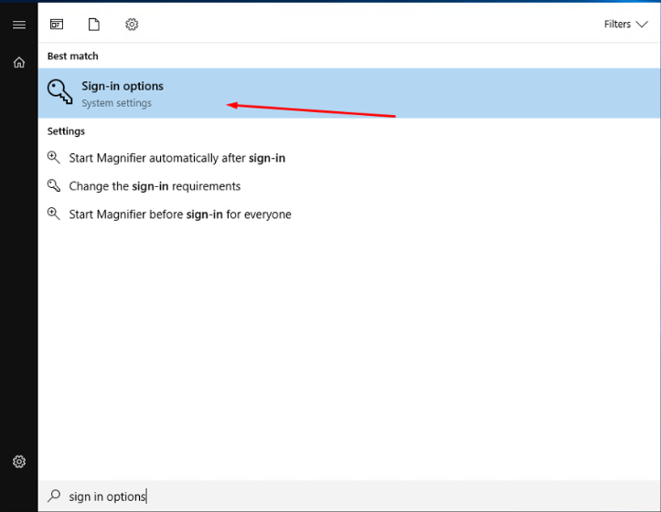
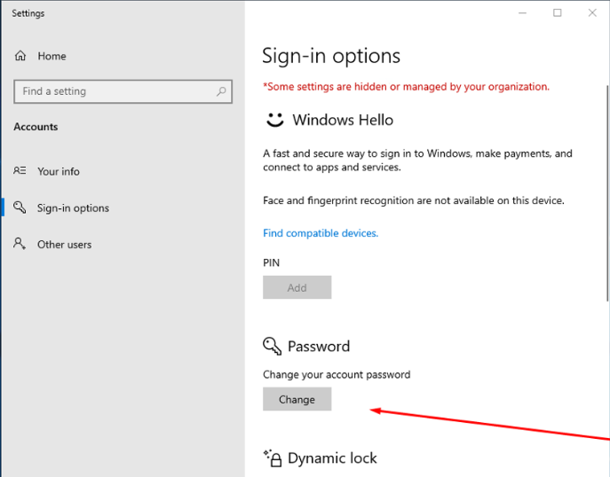
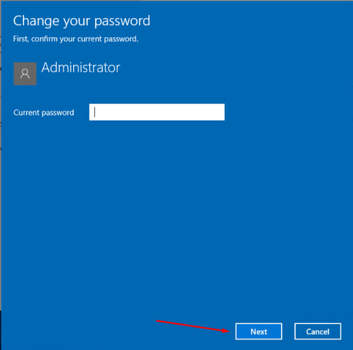
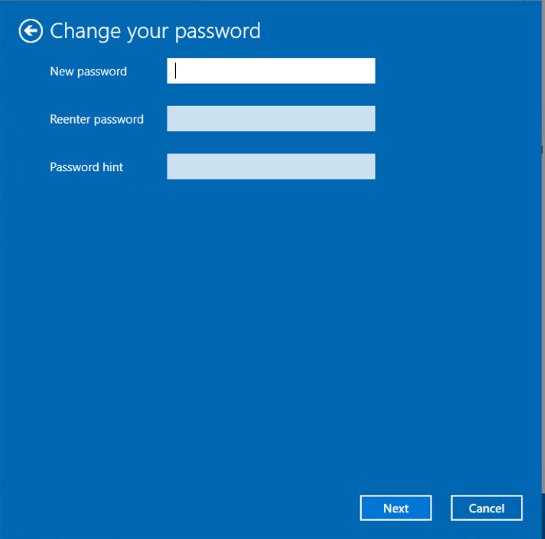

# Schimbarea parolei Windows

Urmează atent acești pași ca să îți schimbi parola Windows prin Remote Desktop.



### Conectează-te prin RDP

Folosește Remote Desktop Connection (RDP) ca să accesezi VPS-ul. Vezi [Conectare prin RDP](rdp-connect.md) dacă ai nevoie de ajutor.



### Caută „sign-in”

Deschide meniul Start din Windows și caută **sign-in**.

<figure><figcaption></figcaption></figure>



### Deschide „Change Password”

Apasă Enter ca să ajungi la pagina **Change Password** (schimbare parolă).

<figure><figcaption></figcaption></figure>



### Introdu parola curentă

Scrie parola actuală și apasă **Next**.

<figure><figcaption></figcaption></figure>



### Setează parola nouă

Introdu și confirmă parola nouă. Adaugă un indiciu pentru parolă, care să te ajute s-o ții minte mai ușor.

<figure><figcaption></figcaption></figure>




Alege o parolă sigură. Păstrează indiciul semnificativ pentru tine, dar nu prea evident pentru alții.

