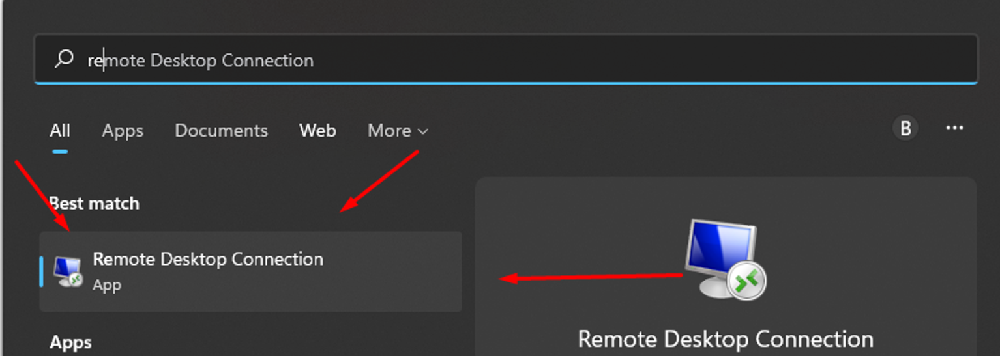
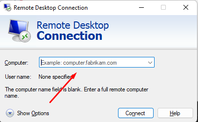
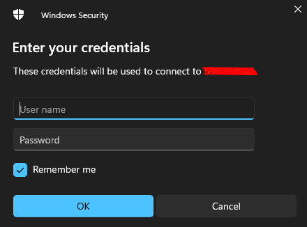

# Conectare prin RDP

Urmează pașii de mai jos ca să te conectezi la VPS-ul sau serverul dedicat care rulează Windows.



### Deschide Remote Desktop Connection

Aplicația vine deja instalată pe PC. Caută **Remote Desktop Connection** în meniul Start.

<figure><figcaption></figcaption></figure>



### Introdu IP-ul VPS-ului

Completează câmpul gol cu adresa IP a VPS-ului.

<figure><figcaption></figcaption></figure>



### Autentifică-te

* **Nume utilizator:** `Administrator`
* **Parolă:** cea afișată în zona ta de client, la [my.rhqhosting.com](https://my.rhqhosting.com).

<figure><figcaption></figcaption></figure>



### Confirmă conexiunea

După autentificare, apasă **Yes** în fereastra care apare.




Nu te poți conecta? Verifică dacă portul TCP `3389` este permis în [firewall](../network/firewall.md). Ca să schimbi parola după aceea, vezi [Schimbarea parolei Windows](password-reset.md).

